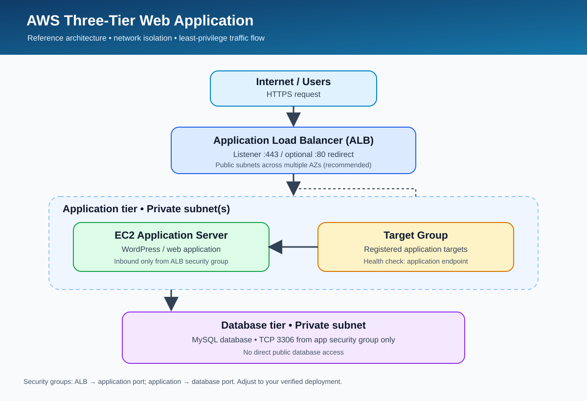

# AWS Three-Tier Web Application Architecture

**A hands-on AWS cloud architecture project focused on traffic routing,
network isolation, and secure application-to-database communication.**


:::

------------------------------------------------------------------------

## 📌 Project Overview

This repository documents a three-tier web application architecture on
Amazon Web Services (AWS). It is designed to separate the public entry
point, application workload, and database layer so each component can be
managed and secured independently.

> **Accuracy note:** This README is a project template. Update the
> implementation status and replace example/placeholder evidence with
> screenshots from your own AWS environment. Do not mark components as
> deployed until you have verified them.

## 🏗️ Architecture Diagram



### Request flow

1.  A user sends an HTTP/HTTPS request to the Application Load Balancer
    (ALB).
2.  The ALB forwards permitted requests to a registered application
    target.
3.  The application server communicates with the MySQL database over the
    database port.
4.  Security groups restrict communication to only the required sources
    and ports.

### Design principles

-   **Public entry point:** expose the ALB to the internet when public
    access is required.
-   **Private application tier:** place application instances in private
    subnets where practical.
-   **Private database tier:** do not expose the database directly to
    the internet.
-   **Least privilege:** allow only required traffic between security
    groups.
-   **Health checks:** configure a health-check path that returns a
    successful response from the application.

## 🧰 Technologies

  -----------------------------------------------------------------------
  Service / Tool                      Purpose
  ----------------------------------- -----------------------------------
  Amazon VPC                          Network boundary for AWS resources

  Public and private subnets          Separate internet-facing and
                                      internal resources

  Amazon EC2                          Compute for the application tier

  Application Load Balancer           Distribute incoming HTTP/HTTPS
                                      requests

  Target Group                        Register application targets and
                                      check their health

  Security Groups                     Control permitted inbound traffic

  WordPress                           Example web application (if used in
                                      your deployment)

  MySQL                               Relational database (if used in
                                      your deployment)
  -----------------------------------------------------------------------

## 🔐 Security Group Design

Use the following as a **recommended starting point**, then adapt it to
the actual deployment:

  ------------------------------------------------------------------------
  Security group   Inbound source                    Port Reason
  ---------------- ---------------- --------------------- ----------------
  ALB security     Approved client                    443 HTTPS entry
  group            IPs or internet,                       point
                   as required                            

  ALB security     Approved client                     80 Optional HTTP
  group            IPs or internet,                       redirect to
                   as required                            HTTPS

  Application      ALB security          Application port Only the load
  security group   group                        (e.g. 80) balancer reaches
                                                          the app

  Database         Application                       3306 Only the
  security group   security group                         application tier
                                                          reaches MySQL

  Administration   Trusted IP or     22, if SSH is needed Restricted
                   Systems Manager                        administration
  ------------------------------------------------------------------------

**Important:** Do not open SSH (22) or MySQL (3306) to `0.0.0.0/0`.
Prefer AWS Systems Manager Session Manager for administration when
available.

## 📁 Repository Structure

``` text
aws-three-tier-web-application/
├── architecture/
│   └── three-tier-architecture.svg
├── screenshots/
│   └── README.md
├── docs/
│   └── implementation-notes.md
├── README.md
└── .gitignore
```

## 🖼️ Implementation Evidence

Add your own AWS Console screenshots to the `screenshots/` directory.
Suggested evidence:

1.  VPC and subnet layout
2.  Route tables and internet/NAT routing (if configured)
3.  EC2 instances and subnet placement
4.  ALB listeners and target group health
5.  Application and database security group rules
6.  Application reachable through the ALB DNS name
7.  Database connectivity test from the application tier (hide
    credentials and sensitive details)

Use descriptive filenames, for example `01-vpc-subnets.png` and
`04-alb-target-health.png`. Only upload screenshots from your own
environment. Review images for account IDs, public IPs, hostnames, keys,
tokens, and other sensitive information before publishing.

## 🚀 Implementation Checklist

-   [ ] Create a VPC and plan the subnet layout
-   [ ] Configure route tables and required gateways
-   [ ] Deploy the application tier
-   [ ] Create and configure the database tier
-   [ ] Configure security groups using least privilege
-   [ ] Create the target group and configure health checks
-   [ ] Create the ALB and listener rules
-   [ ] Test the application through the ALB
-   [ ] Capture and add verified screenshots
-   [ ] Document issues and how they were resolved

## 🧪 Validation and Troubleshooting

Record what you actually tested and the result. Useful checks include:

-   Target group health status
-   ALB listener and target group association
-   Application response through the ALB DNS name
-   Application-to-database connectivity
-   Security group source and destination rules
-   Application and web-server logs

Never include passwords, access keys, private SSH keys, database
credentials, or `.env` files in this repository.

## 💡 Learning Outcomes

-   AWS VPC and subnet design
-   Load balancing and target health checks
-   Security group-based traffic control
-   Separation of application and database tiers
-   Practical cloud troubleshooting and technical documentation

## 📌 Project Status

**Current status:** Documentation starter prepared; deployment status
must be updated based on verified resources.

After completing a task, update the checklist and add a short note about
the configuration, test performed, and outcome.

## 👤 Author

**Abhiket Sharma**\
Cloud & DevOps learning portfolio

------------------------------------------------------------------------

If you found this project useful, feel free to star the repository.
Feedback and suggestions are welcome.
